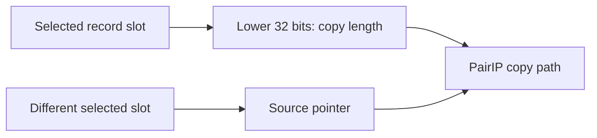

# PairIP crash-path investigation: observed inputs, unresolved origin

**Status: investigation in progress · evidence reviewed 8 October 2026**

This note describes an independent analysis of failures observed with Grok 1.13.0 and Lumo 2.1.3-gms on an ARM64 Android device. It reports what the retained crash records and native instructions establish. The detailed Grok tombstone discussed below reports **326 seconds of process uptime**; it must not be conflated with the separately reported near-immediate startup failures. This work does **not** identify a regional trigger, an original bad-byte writer, or a fix. The updated Grok 1.14.0 app did not fail in one later startup check, so results from the older binaries must not be applied to it without remapping and reproduction.

[Selected evidence and source hashes](EVIDENCE.md) accompany this note.

## What the older Grok crash shows

One retained Grok tombstone reports a native `SIGSEGV` in a PairIP copy path. The copy length register was `x26 = 0x03865f6f` (59,137,903 bytes). A nearby native-instruction slice shows how that value and the source pointer were obtained:

```text
0x373d4  ldr  x27, [x28, w5, uxtw]   record from one selected slot
0x3742c  sxtw x26, w27               signed lower 32 bits become copy length
0x37444  ldr  x24, [x28, w11, uxtw]  source pointer from a different slot
```

The tombstone has `x27 = 0x75f7830003865f6f`; its **lower** 32 bits are `0x03865f6f`, exactly the reported `x26`. An earlier interpretation called this the upper word and treated pointer and length as a single-slot pair. The instruction sequence does not support that interpretation. The meaning of `x27`'s upper word is still unknown.



The crash identifies bad values at the point of use. It does not identify which earlier operation wrote them or whether they were decoded or selected incorrectly.

## Related observations and limits

- A separate Grok crash path uses a signed halfword count. A Lumo path selects a pointer slot using `(w26 XOR cursor-selected w12) mod w20`. Similar shapes do not establish that these are the same virtual-machine opcode or share one cause.
- The retained capture records contain **zero hits** at the intended operand-capture points. GDB's breakpoint-creation announcements do not prove target-side insertion; no remote `Z1`/`OK` exchange was retained. No before/after pair of source-slot bytes has been captured.
- Nine events named `target_exited` cannot be counted as nine app deaths: seven corresponding console sessions end in a debugger detach. Five recorded `SIGSEGV` stops are signal-stop observations, not independently proven fatal outcomes.
- A helper containing the `CLNGC++` marker is consistent with ordinary C++ exception machinery. Its presence does not establish an out-of-memory cause or show that it ran in the failing path.

The reviewed Grok 1.13.0 `libpairipcore.so` has SHA-256 `d83f5775ba1b0f7e45de9527ab8281623e609b70d44d4f0e31c6914fa1b2506a`. This hash pins the instruction offsets above to that binary only.

## Updated environment check

On 8 October, the installed apps were Grok 1.14.0 and Lumo 2.1.4-gms, with different PairIP libraries. The new Grok library has SHA-256 `5af6e1929517356cd6ad77235b79378cdd1d05618e004503c711fb56e214281b`. Both old 16-byte breakpoint fingerprints are absent from that library. The existing capture profile therefore rejects it before arming breakpoints.

In one bounded startup observation, Grok 1.14.0 loaded its PairIP library, displayed its main activity, and remained running through a 29.7-second local log capture. No matching fatal-signal, fatal-exception, crash-dumper, or tombstone event appeared in that window. A separate older symptom reportedly occurred on startup before any screen appeared. This single successful launch does **not** prove a fix, address the 326-second t26 crash, or isolate which software change mattered.

## Next evidence needed

1. Reproduce and distinguish the near-immediate startup failure from the later t26 crash with precisely identified app binaries and system environments.
2. Map the relevant load instructions in that exact binary; old offsets cannot be reused after an update.
3. Capture one correlated case before and after the source-pointer load, retaining the slot bytes, process outcome, and debugger transcript.
4. Trace the writer or decoder of the bad slot values before proposing a cause or patch.

A rooted ARM64 Android VM can validate the capture workflow without changing the phone. It becomes evidence for the original defect only if the **same crash path** reproduces there. Android's [AOSP emulator images can provide root access](https://developer.android.com/studio/run/managing-avds), but they lack Google apps and services; this difference may change startup behavior. A rooted physical test environment or a debuggable build preserving the same PairIP path is another route. Neither has yet produced the missing correlated capture.

## Publication boundary

This draft contains selected instruction and register excerpts plus binary hashes. Full device logs, APKs, native libraries, account details, device serials, memory maps, and debugger transcripts remain in a private evidence set. They need separate review before any wider release. No package was modified or installed during the updated-device check.
